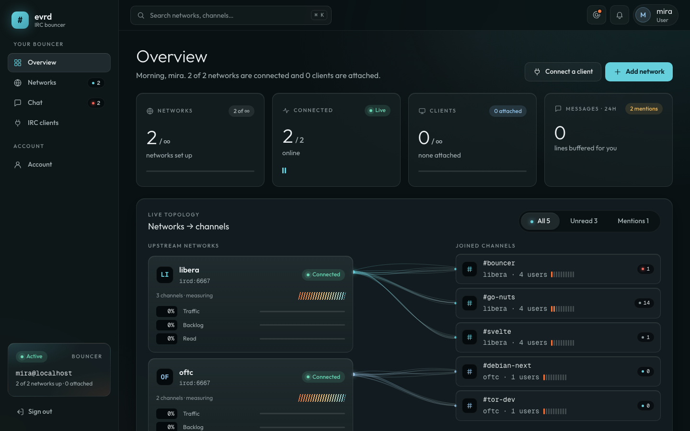
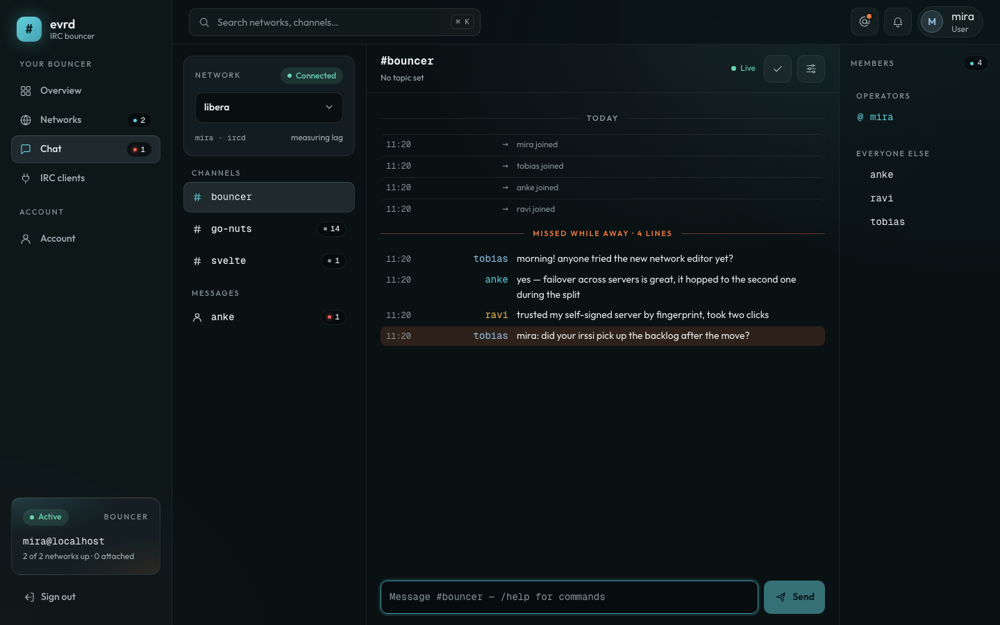
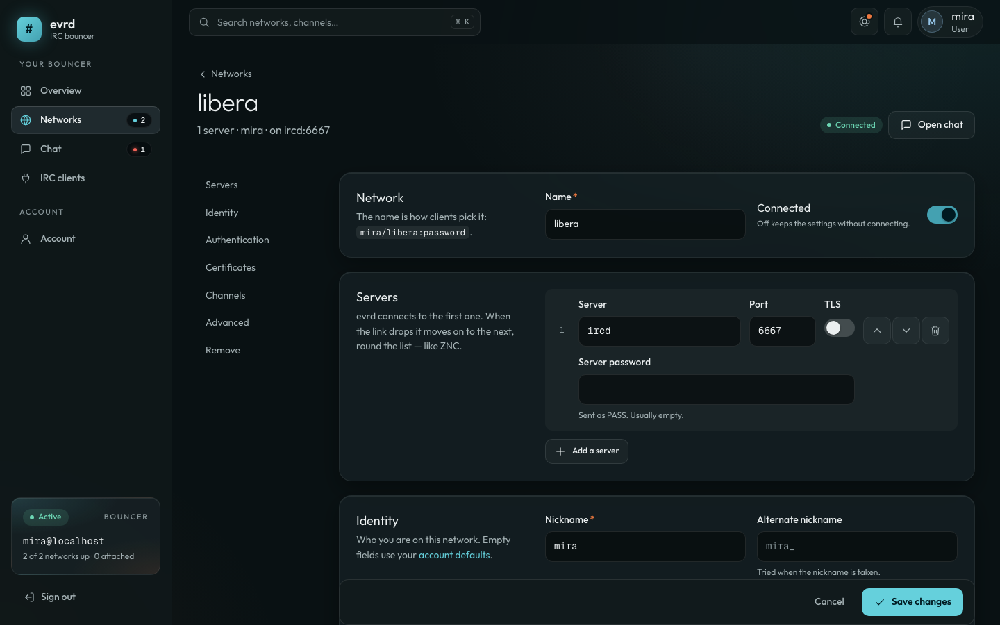

<p align="center">
  
</p>

<h1 align="center">evrd</h1>

<p align="center">
  <b>An always-connected IRC bouncer with a web app.</b><br>
  evrd stays on your IRC networks while you're away and catches you up when you're back —<br>
  from irssi, WeeChat, HexChat or any other client, or right in the browser.
</p>

<p align="center">
  <a href="https://4evrd.github.io">Website</a> ·
  <a href="#quick-start">Quick start</a> ·
  <a href="docs/configuration.md">Configuration</a> ·
  <a href="docs/irc-clients.md">IRC clients</a> ·
  <a href="docs/clustering.md">Clustering</a> ·
  <a href="docs/development.md">Development</a>
</p>



## Features

- **Always connected.** evrd keeps each of your networks connected, reconnects
  with backoff, fails over across several servers, and keeps the history.
- **Bring any client.** Attach irssi, WeeChat, HexChat, … with a server
  password and get what you missed, then the live feed. Several clients and
  the web app share one connection and stay in sync.
- **A web app too.** Chat in the browser, with unread counts, mentions, a
  "missed while away" marker, members and topics. Manage networks, client
  passwords and your account; admins manage users and server settings.
- **ZNC-style settings, without the config file.** Per network: servers,
  nick and alternate nick, ident, SASL, certificate trust (fingerprints,
  self-signed servers), channel keys and detached channels, encodings, flood
  protection. Per user: playback, timestamps, CTCP replies, allowed addresses.
  `*status` works from any client.
- **Accounts.** Password or single sign-on (OpenID Connect: Logto, Authentik,
  Keycloak, …), per-device IRC client passwords, roles and per-user limits.
  Saved network passwords are encrypted at rest.
- **Grows with you.** One container on a small VPS, or several nodes behind a
  load balancer sharing Postgres and ScyllaDB.
- **Dashboards.** Optional metrics (OpenTelemetry → VictoriaMetrics) for
  traffic charts, lag and link health.

<table>
  <tr>
    <td></td>
    <td></td>
  </tr>
</table>

## Quick start

You need a Linux host with Docker (Compose v2). evrd runs as three containers:
the bouncer, its web app, and Postgres. Chat history is kept on a volume.

**1. Get the deployment files**

```sh
git clone https://github.com/4evrd/evrd.git
cd evrd/deploy/docker
```

(You only need the three files in [`deploy/docker/`](deploy/docker):
`docker-compose.yml`, `evrd.conf` and `.env.example`.)

The images are published to GitHub's registry as `ghcr.io/4evrd/evrd` and
`ghcr.io/4evrd/evrd-web` (amd64 and arm64), no login needed.

**2. Set the secrets**

```sh
cp .env.example .env
docker run --rm --entrypoint evrctl ghcr.io/4evrd/evrd genkey   # → EVRD_SECRET_KEY
```

Put that key and a long random `POSTGRES_PASSWORD` in `.env`. The key encrypts
saved network passwords — **keep a copy somewhere safe**; without it they
can't be read back.

**3. Say where it lives**

In `evrd.conf`, set `public_url` (the web app's address) and `irc_host` (what
users type into their IRC client):

```
public_url https://bnc.example.org
irc_host   bnc.example.org
```

**4. Start it and make the first admin**

```sh
docker compose up -d
docker compose exec evrd evrctl user add -admin yourname 'a-long-password'
```

**5. Sign in**

Open the web app — `http://<host>:8080`, or your `public_url` once HTTPS is
set up (below) — sign in, and **Add network** (e.g. `irc.libera.chat`, port
6697, TLS on). evrd connects straight away. To use a desktop client, see
[Connecting an IRC client](#connecting-an-irc-client).

> Testing without HTTPS? Set `cookie_secure no` in `evrd.conf` (and back to
> `yes` for real use), or the browser won't keep you signed in over plain http.

## HTTPS

Put any reverse proxy with TLS in front of the web app on port 8080; it serves
the app and proxies the API (including the WebSocket) to evrd. With
[Caddy](https://caddyserver.com), the whole config is:

```
bnc.example.org {
    reverse_proxy localhost:8080
}
```

IRC clients connect to evrd directly on **6697** (TLS). evrd makes a
self-signed certificate unless you give it one; to use a real one (e.g. the
same Let's Encrypt certificate), mount it into the container and set:

```
tls_cert /etc/evrd/certs/fullchain.pem
tls_key  /etc/evrd/certs/privkey.pem
```

(uncomment the `./certs` volume in `docker-compose.yml`, and restart evrd when
the certificate renews).

## Connecting an IRC client

Each user connects to `irc_host`, port **6697** with TLS, and a **server
password** of `username/network:password`:

```
server:   bnc.example.org/6697   (TLS on)
password: yourname/libera:a-long-password
```

The password is your account password, or — better — an **IRC client password**
made for that device on the web app's *IRC clients* page (accounts that use
single sign-on need one). The page has copy-paste setup for HexChat, irssi and
WeeChat. More, including the `*status` commands: [docs/irc-clients.md](docs/irc-clients.md).

## Configuration

Settings come from `evrd.conf`, and most of them can be changed later in the
web app under **Admin → Settings** (those are stored in the database and win
over the file; environment variables win over both). Things you might set:

| | |
|---|---|
| `public_url`, `irc_host` | where users reach the web app and point IRC clients |
| `max_networks`, `max_clients`, `backlog_lines` | per-user limits (0 = unlimited) |
| `oidc_issuer`, `oidc_client_id`, `oidc_client_secret` | single sign-on with any OpenID Connect provider |
| `password_login` | turn password sign-in off when everyone uses SSO |
| `tls_cert`, `tls_key` | a real certificate for IRC clients |
| `bindhost` | local addresses users may connect from (vhosts) |
| `listen` | extra listeners, e.g. plain IRC on 6667 |

Every directive, network and account settings, and how the web app's settings
layer over the file: [docs/configuration.md](docs/configuration.md).

### Single sign-on

Create an OpenID Connect app in your provider with the redirect URI
`<public_url>/auth/callback`, then:

```
oidc_issuer        https://id.example.org/oidc
oidc_client_id     <client id>
oidc_client_secret <secret>         # or EVRD_OIDC_CLIENT_SECRET
oidc_label         Example ID       # "Continue with Example ID"
```

Accounts are created on first sign-in. Details:
[docs/configuration.md](docs/configuration.md#accounts-and-sign-in).

### Metrics

For the traffic charts and link health on the dashboard, start
VictoriaMetrics alongside and point evrd at it:

```sh
docker compose --profile metrics up -d
```

```
otel_endpoint http://victoriametrics:8428/opentelemetry/v1/metrics
metrics_url   http://victoriametrics:8428
```

Everything works without it; the charts just say metrics are off.

## Upgrading

Releases are listed on the [releases page](https://github.com/4evrd/evrd/releases)
and published as image tags (`0.1.0`, `0.1`, `latest`). Pin one in `.env` with
`EVRD_VERSION=0.1.0`, then:

```sh
docker compose pull
docker compose up -d
```

Database changes are applied automatically at startup.

## Backups

Three things hold your data:

- **Postgres** — accounts, networks, settings:
  `docker compose exec postgres pg_dump -U evrd evrd > evrd.sql`
- **The `evrd-data` volume** — chat history (stop evrd while copying it, or
  accept a few seconds' loss).
- **`EVRD_SECRET_KEY`** — keep it apart from the database backup; it's what
  makes the saved network passwords in that backup unreadable to anyone else.

## Running without Docker

evrd is a single static binary (Linux, macOS, BSD; amd64 and arm64):

```sh
CGO_ENABLED=0 go build -o evrd   ./cmd/evrd     # Go 1.26
CGO_ENABLED=0 go build -o evrctl ./cmd/evrctl
cd web && pnpm install && pnpm build          # the web app → web/build/
```

Run `evrd -config /etc/evrd/evrd.conf` (as its own user, e.g. under systemd),
serve `web/build/` as static files with a fallback to `index.html`, and proxy
`/api/` (with WebSocket upgrade) and `/auth/` to evrd's `api` address — the
nginx template in [`web/templates/`](web/templates/default.conf.template) shows
how. `db sqlite:/var/lib/evrd/evrd.db` and `history pebble:/var/lib/evrd/history`
need no database server at all.

## More nodes

When one machine isn't enough, run several evrd nodes against shared Postgres
and ScyllaDB behind a round-robin load balancer; each user lives on one node
and moves if it fails. See [docs/clustering.md](docs/clustering.md).

## Developing

The dev stack (hot reload, a local IRC server, two nodes), tests, CI and how
releases are cut: [docs/development.md](docs/development.md). Commit messages
follow [Conventional Commits](https://www.conventionalcommits.org) — they
decide the next version.
